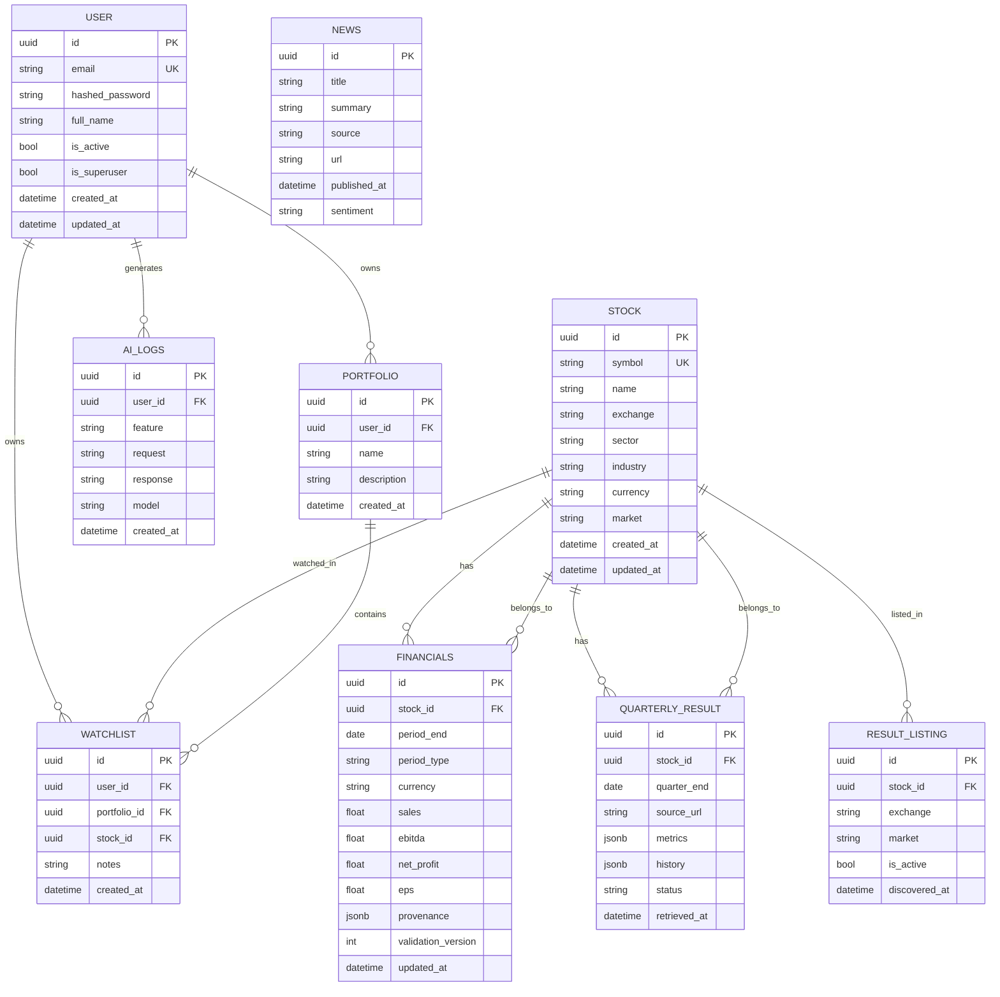
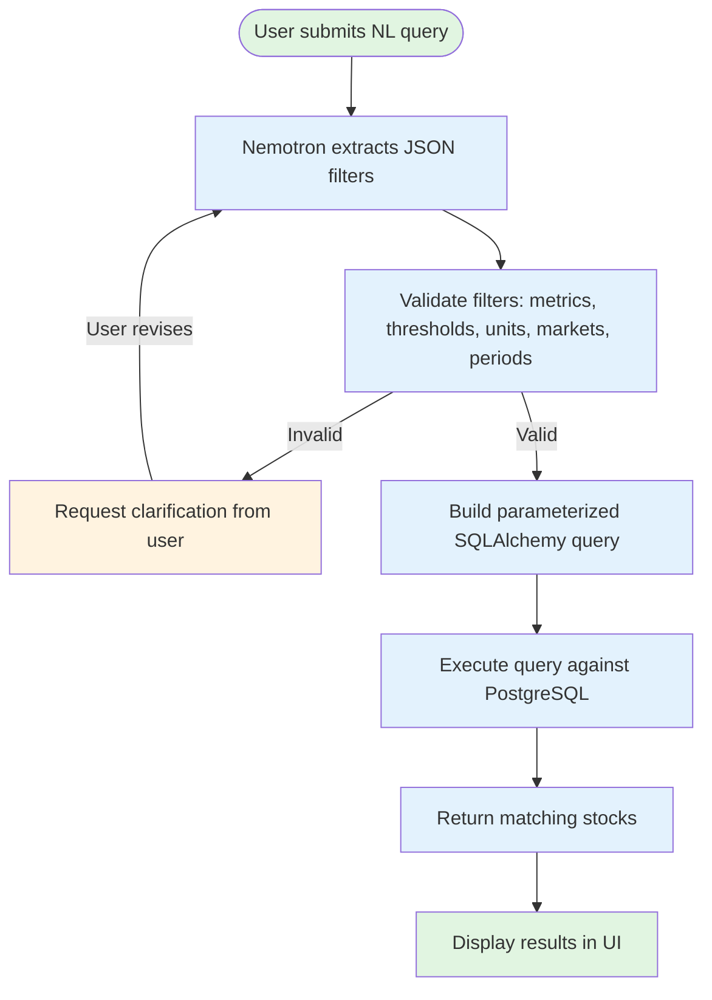
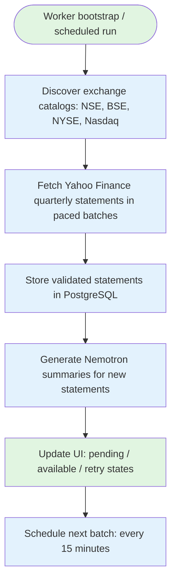
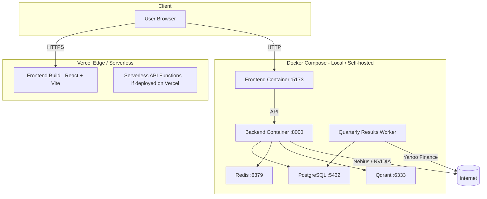

# Architecture — Asset Hunter (Screen Finance)

This document contains three diagrams:

1. **Basic Flow Diagram** — end-to-end user flow to understand how the project works
2. **HLD (High-Level Design)** — system architecture, components, infrastructure, and data flow
3. **LLD (Low-Level Design)** — detailed module, class, database schema, and API contract design

---

## 1. Basic Flow Diagram (User Journey)

This diagram shows how a user interacts with Asset Hunter from sign-in to AI-powered stock research.

```mermaid
flowchart TD
    %% Users
    U[User / Trader / Investor]

    %% Frontend
    F[React + Vite Frontend<br/>localhost:5173]
    LA[Login / Register Page]
    DH[Dashboard / Home Page]
    SC[AI Screener Page]
    SA[Stock Analysis Page]
    RS[Quarterly Results Page]
    PO[Portfolio Page]

    %% Backend
    BE[FastAPI Backend<br/>localhost:8000]
    AU[Auth Service<br/>JWT + Google OAuth]
    DB[(PostgreSQL<br/>stocks, financials,<br/>users, watchlists)]
    RD[(Redis<br/>cache & sessions)]
    QD[(Qdrant<br/>vector store)]

    %% External
    YF[Yahoo Finance / yfinance]
    NF[Nebius Token Factory<br/>NVIDIA Nemotron]

    %% Flow
    U -->|1. Open browser| F
    F -->|2. Register / Sign in| LA
    LA -->|3. Validate credentials| AU
    AU -->|4. Issue JWT| F
    F -->|5. Browse stocks / screener| DH
    DH -->|6. Enter NL query<br/>"Find US ROE > 20%"| SC
    SC -->|7. Send query| BE
    BE -->|8. Nemotron extracts filters| NF
    NF -->|9. Return JSON filters| BE
    BE -->|10. Parameterized SQL query| DB
    DB -->|11. Return matching stocks| BE
    BE -->|12. Return results| SC
    SC -->|13. Display results| F
    F -->|14. Select a stock| SA
    SA -->|15. Request AI analysis| BE
    BE -->|16. Fetch financial evidence| DB
    BE -->|17. Generate summary| NF
    NF -->|18. Return analysis| BE
    BE -->|19. Display report| SA
    F -->|20. View quarterly results| RS
    BE -->|21. Worker fetches Yahoo data| YF
    YF -->|22. Store quarterly statements| DB
    RS -->|23. Display catalog| F

    subgraph Frontend Layer
        F
        LA
        DH
        SC
        SA
        RS
        PO
    end

    subgraph Backend Layer
        BE
        AU
    end

    subgraph Data & AI Layer
        DB
        RD
        QD
        YF
        NF
    end
```

---

## 2. HLD (High-Level Design)

The High-Level Design shows the overall system architecture, major components, infrastructure, and how data flows between services.

```mermaid
C4Context
    title System Context — Asset Hunter

    Person(user, "User / Investor", "Trades US & Indian equities, uses AI screening & analysis")
    System(frontend, "Frontend (React + Vite)", "SPA for dashboard, screener, stock analysis, portfolio, results")
    System(backend, "Backend (FastAPI)", "REST API, auth, AI agents, workers, market data ingestion")
    System(db, "PostgreSQL", "Stocks, financials, users, watchlists, portfolios, quarterly results")
    System(redis, "Redis", "Caching, session storage, Celery broker")
    System(qdrant, "Qdrant", "Vector store for RAG / embeddings (optional)")
    System(yf, "Yahoo Finance (yfinance)", "Quarterly statements, exchange directory discovery")
    System(nebius, "Nebius Token Factory", "Hosted NVIDIA Nemotron inference for AI features")
    System(nvidia, "NVIDIA API", "Direct Nemotron inference fallback")

    Rel(user, frontend, "Accesses UI", "HTTPS / WSS")
    Rel(frontend, backend, "API calls", "REST / JSON")
    Rel(backend, db, "Read / write", "SQLAlchemy asyncpg")
    Rel(backend, redis, "Cache / broker", "Redis protocol")
    Rel(backend, qdrant, "Vector search", "REST / gRPC")
    Rel(backend, yf, "Fetch market data", "HTTPS")
    Rel(backend, nebius, "AI inference", "OpenAI-compatible client")
    Rel(backend, nvidia, "AI inference fallback", "HTTPS")

    Rel_None(frontend, yf, "No direct access")
    Rel_None(user, db, "No direct access")
```

```mermaid
C4Container
    title Container Architecture — Asset Hunter

    Container_Browser(browser, "Browser", "Chrome, Firefox, Safari, Edge", "HTML/JS/CSS")
    Container(frontend, "Frontend (React + Vite)", "JavaScript, Vite, Tailwind", "Serves SPA on :5173")
    Container(backend, "Backend (FastAPI)", "Python 3.11, FastAPI, SQLAlchemy, LangGraph", "REST API on :8000")
    ContainerDb(db, "PostgreSQL 16", "SQL", "stocks, financials, users, watchlists, portfolios, quarterly_results, ai_logs")
    ContainerDb(redis, "Redis 7", "In-memory", "Cache, sessions, Celery broker")
    ContainerDb(qdrant, "Qdrant", "Vector DB", "Embeddings for RAG (optional)")
    Container(browser_worker, "Quarterly Worker", "Python, Celery", "Bootstrap + scheduled Yahoo Finance ingestion")
    ContainerExt(yf, "Yahoo Finance", "External API", "Quarterly data, exchange directories")
    ContainerExt(nebius, "Nebius Token Factory", "External API", "Nemotron 3 Super / Ultra inference")
    ContainerExt(nvidia, "NVIDIA API", "External API", "Direct Nemotron inference")

    Rel_Browser(frontend, browser, "Loads SPA", "HTTPS")
    Rel(frontend, backend, "API requests", "REST / JSON over HTTPS")
    Rel(backend, db, "Queries", "asyncpg / SQLAlchemy")
    Rel(backend, redis, "Cache / pub-sub", "Redis")
    Rel(backend, qdrant, "Vector search", "REST")
    Rel(browser_worker, db, "Store statements", "SQLAlchemy")
    Rel(browser_worker, yf, "Fetch quarterly data", "HTTPS")
    Rel(backend, nebius, "AI inference", "OpenAI-compatible client")
    Rel(backend, nvidia, "AI fallback", "HTTPS")

    containerDb(db, "PostgreSQL", "SQL", "Relational data")
    containerDb(redis, "Redis", "In-memory", "Cache & broker")
    containerDb(qdrant, "Qdrant", "Vector", "RAG embeddings")
```

```mermaid
C4Component
    title Component Architecture — Backend (FastAPI)

    Container(api_gateway, "API Gateway / Router", "FastAPI routers", "v1 routes: auth, stocks, screener, ai, results, portfolio, watchlist, news, filing, admin")
    Container(auth_service, "Auth Service", "JWT, password hashing, Google OAuth", "login, register, refresh, logout, profile")
    Container(screener_service, "NL Screener Service", "Nemotron filter extraction + SQLAlchemy query builder", "Parse NL → JSON filters → validated SQL → results")
    Container(analysis_service, "AI Stock Analysis Service", "Financial evidence validation + Nemotron summarization", "Generate summary, strengths, risks, watch items")
    Container(quarterly_service, "Quarterly Results Service", "YoY / QoQ growth calculation + validation", "List quarterly results with filters, pagination, coverage")
    Container(stock_service, "Stock Service", "Stock metadata, sync, search", "Symbol lookup, company info, market data")
    Container(portfolio_service, "Portfolio Service", "Watchlists, portfolios, holdings", "CRUD for user portfolios & watchlists")
    Container(news_service, "News Service", "Market news aggregation", "News feed, sentiment")
    Container(filings_service, "Filings Service", "Document ingestion & parsing", "SEC / annual report processing")
    Container(embeddings_service, "Embeddings Service", "Vector embedding generation", "RAG for financial documents")
    Container(db_layer, "Database Layer", "SQLAlchemy + Alembic migrations", "Async session, connection pooling")
    Container(cache_layer, "Cache Layer", "Redis client", "TTL caching, session store")
    Container(vector_layer, "Vector Layer", "Qdrant client", "Similarity search, upsert, delete")
    Container(worker_layer, "Worker Layer", "Celery workers", "quarterly, stock_sync, news, filings, embeddings")

    Rel(api_gateway, auth_service, "routes to")
    Rel(api_gateway, screener_service, "routes to")
    Rel(api_gateway, analysis_service, "routes to")
    Rel(api_gateway, quarterly_service, "routes to")
    Rel(api_gateway, stock_service, "routes to")
    Rel(api_gateway, portfolio_service, "routes to")
    Rel(api_gateway, news_service, "routes to")
    Rel(api_gateway, filings_service, "routes to")
    Rel(api_gateway, embeddings_service, "routes to")
    Rel(api_gateway, db_layer, "uses")
    Rel(api_gateway, cache_layer, "uses")
    Rel(api_gateway, vector_layer, "uses")

    Rel(screener_service, db_layer, "queries")
    Rel(analysis_service, db_layer, "reads evidence")
    Rel(quarterly_service, db_layer, "reads financials")
    Rel(stock_service, db_layer, "reads / writes")
    Rel(portfolio_service, db_layer, "reads / writes")
    Rel(news_service, db_layer, "reads / writes")
    Rel(filings_service, db_layer, "reads / writes")
    Rel(embeddings_service, db_layer, "reads")
    Rel(embeddings_service, vector_layer, "writes vectors")

    Rel(worker_layer, db_layer, "writes statements")
    Rel(worker_layer, yf, "fetches data")
```

---

## 3. LLD (Low-Level Design)

The Low-Level Design shows detailed module structure, class relationships, database schema, API contracts, and data flow within each component.

### 3.1 Module Structure (Backend)

```mermaid
graph TD
    subgraph main [app/main.py]
        app[FastAPI Application]
        mw[Middleware: CORS, Auth, Logging, Error Handling]
        event[Startup / Shutdown Events]
    end

    subgraph api [app/api/v1/]
        auth[auth.py - login, register, refresh, logout]
        stocks[stocks.py - symbol search, company info]
        screener[screener.py - NL screening endpoint]
        ai[ai.py - stock analysis endpoint]
        results[results.py - quarterly results endpoint]
        portfolio[portfolio.py - watchlist & portfolio CRUD]
        watchlist[watchlist.py - watchlist management]
        news[news.py - market news]
        filing[filing_results.py - document filings]
        ingestion[ingestion.py - data ingestion]
        admin[admin.py - admin operations]
    end

    subgraph agents [app/agents/]
        screener_graph[langgraph/screener/graph.py - LangGraph screening workflow]
        crewai[crewai/ - CrewAI agents (placeholder)]
        prompts[prompts/ - system & user prompt templates]
    end

    subgraph services [app/services/]
        screener_svc[screener/ - filter extraction, query building, validation]
        ai_svc[ai/ - stock_analysis, financial_evidence, sentiment, recommendation, embeddings, rag]
        quarterly[quarterly_results.py - YoY/QoQ, format_result, list_results]
        market[market/ - market data providers]
        news_service[news_service.py - news aggregation]
        parser[parser/ - document parsers]
        notification[notification/ - alerts]
    end

    subgraph core [app/core/]
        auth[auth.py - JWT creation & verification]
        cache[cache.py - Redis cache wrapper]
        settings[settings.py - Pydantic settings / env config]
        security[security.py - password hashing]
        logger[logger.py - structured logging]
    end

    subgraph db [app/db/]
        session[session.py - async session factory]
        postgres[postgres.py - engine & connection]
        redis[redis.py - Redis client]
        qdrant[qdrant.py - Qdrant client]
        base[base.py - SQLAlchemy declarative base]
        migrations[migrations/ - Alembic migrations]
    end

    subgraph models [app/models/]
        user[user.py - User model]
        stock[stock.py - Stock model]
        financials[financials.py - Financials model]
        quarterly[quarterly_result.py - QuarterlyResult model]
        result_listing[result_listing.py - ResultListing model]
        portfolio[portfolio.py - Portfolio model]
        watchlist[watchlist.py - Watchlist model]
        news[news.py - News model]
        ai_logs[ai_logs.py - AI interaction logs]
        poll_state[quarterly_poll_state.py - Worker poll state]
    end

    subgraph utils [app/utils/]
        helpers[utility functions]
        validation[data validation helpers]
    end

    subgraph workers [app/workers/]
        qrw[quarterly_results_worker.py - bootstrap + scheduled ingestion]
        ssw[stock_sync_worker.py - sync US/Indian stocks]
        nw[news_worker.py - news ingestion]
        fw[filing_worker.py - filing processing]
        ew[embeddings_worker.py - vector embeddings]
        cw[celery_worker.py - Celery app config]
    end

    main --> api
    main --> agents
    main --> services
    main --> core
    main --> db
    main --> models
    main --> utils
    main --> workers
    api --> services
    agents --> services
    services --> db
    services --> models
    workers --> db
    workers --> services
```

### 3.2 Database Schema (Entity-Relationship)



### 3.3 API Contract (v1)

```mermaid
graph LR
    subgraph Auth
        A1[POST /api/v1/auth/register]
        A2[POST /api/v1/auth/login]
        A3[POST /api/v1/auth/refresh]
        A4[POST /api/v1/auth/logout]
        A5[GET /api/v1/auth/me]
    end

    subgraph Stocks
        S1[GET /api/v1/stocks/search?q=]
        S2[GET /api/v1/stocks/{symbol}]
        S3[GET /api/v1/stocks]
    end

    subgraph Screener
        SC1[POST /api/v1/screener/query]
        SC2[GET /api/v1/screener/filters]
    end

    subgraph AI
        AI1[POST /api/v1/ai/analyze/{symbol}]
        AI2[GET /api/v1/ai/analysis/{symbol}]
    end

    subgraph Results
        R1[GET /api/v1/results]
        R2[GET /api/v1/results/latest]
        R3[GET /api/v1/results/{ticker}]
    end

    subgraph Portfolio & Watchlist
        P1[GET /api/v1/portfolio]
        P2[POST /api/v1/portfolio]
        W1[GET /api/v1/watchlist]
        W2[POST /api/v1/watchlist/{symbol}]
    end

    subgraph News & Filings
        N1[GET /api/v1/news]
        F1[GET /api/v1/filings/{symbol}]
    end

    subgraph Admin
        AD1[GET /api/v1/admin/stats]
        AD2[POST /api/v1/admin/refresh]
    end
```

### 3.4 NL Screener Flow (LangGraph)



### 3.5 AI Stock Analysis Flow

```mermaid
flowchart TD
    Start([User clicks "Analyze with AI"]) --> Fetch[Fetch financial evidence from DB]
    Fetch --> Validate[Validate evidence: calculations, identity, currencies, periods, source refs]
    Validate --> Select[Nemotron selects & ranks findings]
    Select --> Compose[Compose summary, strengths, risks, watch items]
    Compose --> Render[Render verified sentences with citations]
    Render --> Display[Display AI analysis report]

    style Start fill:#e1f5e1
    style Display fill:#e1f5e1
    style Fetch fill:#e3f2fd
    style Validate fill:#e3f2fd
    style Select fill:#e3f2fd
    style Compose fill:#e3f2fd
    style Render fill:#e3f2fd
```

### 3.6 Quarterly Results Worker Flow



### 3.7 Frontend Component Hierarchy

```mermaid
graph TD
    App[App.jsx - Root]
    Routes[Routes.jsx - Routing]
    
    subgraph Pages
        Home[Home Page]
        Auth[Auth Pages - Login/Register]
        Screener[AI Screener Page]
        Stock[Stock Detail Page]
        Results[Quarterly Results Page]
        Portfolio[Portfolio Page]
        Admin[Admin Page]
    end
    
    subgraph Components
        UI[ui/ - shadcn/ui primitives]
        Charts[charts/ - stock charts]
        AI[ai/ - AI chat & analysis components]
        Common[common/ - shared components]
        StockC[stock/ - stock cards, lists]
        ScreenerC[screener/ - screener filters, results]
        AuthC[auth/ - auth forms]
        NewsC[news/ - news cards]
    end
    
    subgraph Services
        API[api.js - Axios instance]
        AuthS[auth.service.js]
        StockS[stock.service.js]
        ScreenerS[screener.service.js]
        AIS[ai.service.js]
        WatchlistS[watchlist.service.js]
    end
    
    subgraph Store
        Store[Zustand / Context - auth, portfolio, watchlist state]
    end
    
    App --> Routes
    Routes --> Pages
    Pages --> Components
    Components --> Services
    Services --> Store
    
    style App fill:#e1f5e1
    style Routes fill:#e3f2fd
    style Store fill:#fff3e0
```

### 3.8 Data Flow Summary

```
┌─────────────┐      ┌──────────────┐      ┌─────────────────┐
│   User      │────→ │   Frontend   │────→ │    Backend      │
│  (Browser)  │      │  (React)     │      │  (FastAPI)      │
└─────────────┘      └──────────────┘      └────────┬────────┘
                                                    │
                    ┌───────────────────────────────┼───────────────────────────────┐
                    │                               │                               │
                    ▼                               ▼                               ▼
            ┌─────────────┐                 ┌─────────────┐                 ┌─────────────┐
            │ PostgreSQL  │                 │     Redis   │                  │   Qdrant  │
            │ (Primary)   │                 │  (Cache)    │                 │ (Vector)  │
            └─────────────┘                 └─────────────┘                 └─────────────┘
                                                    │
                                                    ▼
                                            ┌─────────────┐
                                            │ Yahoo Finance│
                                            │   (yfinance)  │
                                            └─────────────┘
                                                    │
                                                    ▼
                                            ┌─────────────┐
                                            │ Nebius /    │
                                            │ Nemotron AI  │
                                            └─────────────┘
```

### 3.9 Deployment Architecture



---

## Summary Table

| Layer | Technology | Responsibility |
|-------|-----------|----------------|
| Frontend | React + Vite + Tailwind | UI: dashboard, screener, stock analysis, portfolio, results |
| Backend | FastAPI + Python 3.11 | REST API, auth, AI agents, workers, business logic |
| Database | PostgreSQL 16 | Stocks, financials, users, watchlists, portfolios, AI logs |
| Cache | Redis 7 | Session cache, Celery broker |
| Vector Store | Qdrant | RAG embeddings (optional) |
| Market Data | Yahoo Finance (yfinance) | Quarterly statements, exchange directories |
| AI Inference | Nebius Token Factory / NVIDIA API | Nemotron 3 Super / Ultra for screening & analysis |
| Workers | Celery | Quarterly ingestion, stock sync, news, filings, embeddings |
| Migrations | Alembic | Database schema versioning |
| Deployment | Docker Compose / Vercel | Containerized local deploy, serverless production |


## Stock discovery coverage update

The discovery UI now has an Indian/US selector and a natural-language prompt. The server applies the selected market deterministically and rejects conflicting prompt coverage. Interpreted conditions are read-only; result pagination and sorting retain the original conditions.

The screening refresh no longer uses a sixteen-stock starter list. `app.workers.stock_sync_worker` reuses the daily NSE/BSE/NYSE/NASDAQ catalog, then fills verified financial snapshots in resumable exchange-balanced batches. Per-listing screening due dates and errors live in `result_listings`, separate from quarterly refresh state. A database lease in `quarterly_poll_state` prevents overlapping screening workers. Migration `f1d53c6249ea` adds the queue columns/index.

S&P 500 membership is a separate current-index restriction backed by a refreshed constituent snapshot (`screener_sp500`), sourced from FMP or the public constituent table. It is not treated as NYSE membership. Missing or stale membership is reported explicitly.

Responses distinguish catalog size (`universe_count`), listings with eligible financial data (`eligible_count`), and matches (`total_count`). The background import progressively expands financial coverage; numeric filters never treat absent financials as matching data.
